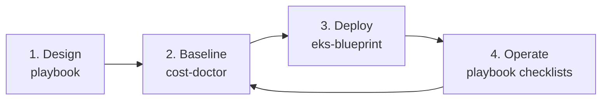

# AWS Outbound Toolkit

> A practical toolkit for taking production workloads global on AWS: methodology, cost tooling, and a production EKS baseline.

[](https://github.com/kudig-io/aws-outbound-toolkit/actions/workflows/docs.yml)
[](https://github.com/kudig-io/aws-outbound-toolkit/actions/workflows/cost-doctor.yml)
[](https://github.com/kudig-io/aws-outbound-toolkit/actions/workflows/eks-blueprint.yml)
[](./LICENSE)

**English** | [简体中文](./README.zh-CN.md)

Most AWS "getting started" material stops at a single service. This toolkit covers the full path a
team actually walks when going global: **decide the architecture, control the bill, and run the
platform**. It is deliberately small enough to read, but complete enough to use as a working baseline.

## What's inside

| Module | What it is | Start here |
| --- | --- | --- |
| [`playbook/`](./playbook/) | Eight-chapter outbound playbook: landing zone, network, compliance, cost, migration, EKS, observability, plus copy-ready checklists | [Playbook index](./playbook/docs/README.md) |
| [`tools/cost-doctor/`](./tools/cost-doctor/) | Go CLI that turns an AWS inventory snapshot into deterministic cost findings (table, Markdown, JSON) | [Cost Doctor](./tools/cost-doctor/README.md) |
| [`infrastructure/eks-blueprint/`](./infrastructure/eks-blueprint/) | Terraform baseline for a three-AZ production EKS cluster with private endpoint, IRSA, and managed addons | [EKS Blueprint](./infrastructure/eks-blueprint/README.md) |

## How the pieces fit



1. **Design** the landing zone, network, and compliance posture with the playbook.
2. **Baseline** the expected cost and find waste before traffic arrives.
3. **Deploy** the platform with the Terraform EKS baseline.
4. **Operate** against the launch-readiness and day-2 checklists, then re-scan cost.

## Quick start

### Playbook

```bash
open playbook/docs/00-overview.md
```

### Cost Doctor

```bash
cd tools/cost-doctor
go run ./cmd/aws-cost-doctor scan --input examples/inventory.json
```

### EKS Blueprint

```bash
cd infrastructure/eks-blueprint
cp examples/prod.tfvars terraform/terraform.tfvars
$EDITOR terraform/terraform.tfvars
make validate
make plan
```

## Repository layout

```text
playbook/
  docs/                 # chapters 00-07
  checklists/           # go-live checklist
  templates/            # VPC, Kubernetes, account-baseline snippets
tools/
  cost-doctor/          # Go CLI, tests, example inventory
infrastructure/
  eks-blueprint/        # Terraform root + modules, Helm values
docs/
  design-decisions.md   # architecture trade-offs and when to revisit them
```

## Design principles

- **Actionable over exhaustive.** Every chapter ends with a checklist; every rule has a recommendation.
- **Deterministic over clever.** The cost tool reads a snapshot and applies transparent rules; no
  hidden pricing model, no credentials, no network.
- **Boring defaults first.** Private endpoints, three AZs, Graviton, managed addons, and explicit
  access entries. Add complexity only when the trade-off is understood.
- **One repository, three entry points.** Docs, tooling, and infrastructure live together so a reader
  can follow the whole story without jumping between projects.

See [docs/design-decisions.md](./docs/design-decisions.md) for the reasoning behind specific choices
and the conditions under which they should change.

## Status

| Module | Status |
| --- | --- |
| Playbook | Draft, usable; continuously refined from real projects |
| cost-doctor | Alpha; schema and rules may change before v0.1.0 |
| EKS blueprint | Early-stage reference; formatted and `terraform validate`-ed in CI, not yet applied to a live account in this repository |

Validate everything against your own security, legal, and commercial requirements before production.

## Contributing

See [CONTRIBUTING.md](./CONTRIBUTING.md). Run `make test` and `make validate` before opening a PR.

## Related projects

- [kudig-io/klaw](https://github.com/kudig-io/klaw) — Kubernetes diagnostics and operations platform
- [kudig-io/kudig-database](https://github.com/kudig-io/kudig-database) — Kubernetes + AI infrastructure knowledge base

## Disclaimer

This project is **not affiliated with, endorsed by, or sponsored by Amazon Web Services (AWS)**.
AWS and related marks are trademarks of Amazon.com, Inc. or its affiliates. All recommendations are
community-maintained and must be validated against your own requirements.

## License

[Apache-2.0](./LICENSE)