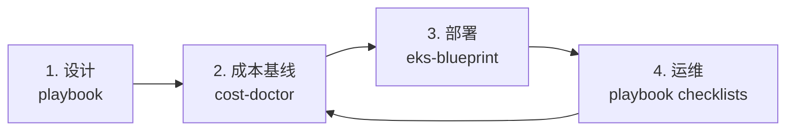

# AWS 出海工具箱

> 一套面向生产环境的 AWS 出海工具集：方法论、成本工具与生产级 EKS 基线。

[](https://github.com/kudig-io/aws-outbound-toolkit/actions/workflows/docs.yml)
[](https://github.com/kudig-io/aws-outbound-toolkit/actions/workflows/cost-doctor.yml)
[](https://github.com/kudig-io/aws-outbound-toolkit/actions/workflows/eks-blueprint.yml)
[](./LICENSE)

[English](./README.md) | **简体中文**

大多数 AWS 入门材料停留在单个服务。这个工具箱覆盖团队出海的完整路径：
**定架构、控成本、跑平台**。它刻意保持可读的体量，但完整到可以作为工作基线直接使用。

## 包含内容

| 模块 | 说明 | 从这里开始 |
| --- | --- | --- |
| [`playbook/`](./playbook/) | 八章出海手册：Landing Zone、网络、合规、成本、迁移、EKS、可观测性，附可直接使用的 Checklist | [手册索引](./playbook/docs/README.md) |
| [`tools/cost-doctor/`](./tools/cost-doctor/) | Go CLI，把 AWS 资源快照转成确定性的成本问题报告（表格、Markdown、JSON） | [Cost Doctor](./tools/cost-doctor/README.zh-CN.md) |
| [`infrastructure/eks-blueprint/`](./infrastructure/eks-blueprint/) | 三可用区生产级 EKS 的 Terraform 基线：私有端点、IRSA、托管插件 | [EKS 基线](./infrastructure/eks-blueprint/README.zh-CN.md) |

## 三者如何配合



1. 用 **playbook** 设计 Landing Zone、网络与合规姿态。
2. 在流量到来前，用 **cost-doctor** 建立成本基线并发现浪费。
3. 用 Terraform EKS 基线**部署**平台。
4. 按上线检查表与 Day-2 清单**运维**，并持续复扫成本。

## 快速开始

### 手册

```bash
open playbook/docs/00-overview.md
```

### Cost Doctor

```bash
cd tools/cost-doctor
go run ./cmd/aws-cost-doctor scan --input examples/inventory.json
```

### EKS 基线

```bash
cd infrastructure/eks-blueprint
cp examples/prod.tfvars terraform/terraform.tfvars
$EDITOR terraform/terraform.tfvars
make validate
make plan
```

## 目录结构

```text
playbook/
  docs/                 # 00-07 章
  checklists/           # 上线检查表
  templates/            # VPC、Kubernetes、账号基线片段
tools/
  cost-doctor/          # Go CLI、测试、示例快照
infrastructure/
  eks-blueprint/        # Terraform 根模块与子模块、Helm values
docs/
  design-decisions.md   # 架构取舍与何时重新评估
```

## 设计原则

- **可执行优先于大而全。** 每章以 Checklist 收尾，每条规则都给出处理建议。
- **确定性优先于聪明。** 成本工具只读取快照并套用透明规则；没有隐藏定价模型、不需要凭证、不联网。
- **先要无聊的默认值。** 私有端点、三可用区、Graviton、托管插件、显式 Access Entry；
  只有理解取舍后才增加复杂度。
- **一个仓库，三个入口。** 文档、工具、基础设施放在一起，读者不必在多个项目间跳转。

具体决策的理由与重新评估条件见 [docs/design-decisions.md](./docs/design-decisions.md)。

## 状态

| 模块 | 状态 |
| --- | --- |
| Playbook | 草稿，可用；持续用真实项目迭代 |
| cost-doctor | Alpha；v0.1.0 前 schema 与规则可能变化 |
| EKS 基线 | 早期参考实现；CI 已做格式检查与 `terraform validate`，尚未在本仓库中应用到真实账号 |

上生产前请结合自身安全、法律与商务要求评估。

## 参与贡献

见 [CONTRIBUTING.md](./CONTRIBUTING.md)。提交 PR 前请执行 `make test` 与 `make validate`。

## 相关项目

- [kudig-io/klaw](https://github.com/kudig-io/klaw) — Kubernetes 诊断与运维平台
- [kudig-io/kudig-database](https://github.com/kudig-io/kudig-database) — Kubernetes + AI 基础设施知识库

## 声明

本项目**与 Amazon Web Services (AWS) 无任何隶属、背书或赞助关系**。AWS 及相关标识是
Amazon.com, Inc. 或其关联公司的商标。所有建议均由社区维护，落地前请结合自身要求进行评估。

## 许可证

[Apache-2.0](./LICENSE)
