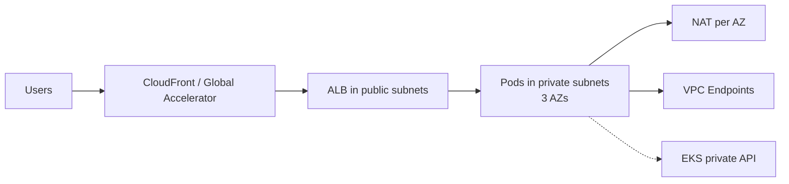

# EKS Production Blueprint

> An opinionated, minimal Terraform baseline for a production Amazon EKS cluster.

[](https://github.com/kudig-io/aws-outbound-toolkit/actions/workflows/eks-blueprint.yml)
[](https://www.terraform.io)
[](../../LICENSE)

**English** | [简体中文](./README.zh-CN.md)

Most EKS examples stop at "cluster created". This blueprint focuses on the defaults that decide
whether the cluster is safe to run in production: private endpoint, three-AZ networking, OIDC for
IRSA, control plane logging, EKS access entries, and a managed node group that can be replaced.

## Status

**Early-stage reference blueprint.** The configuration is formatted and validated in CI, but has not
yet been applied against a live AWS account in this repository. Review the plan, adapt it to your
account structure, and test in a sandbox before production.

## What's included

| Area | Included |
| --- | --- |
| Network | Three-AZ VPC, public/private subnets, NAT gateway per AZ, VPC Flow Logs |
| Cluster | Private API endpoint by default, all five control plane log types |
| Identity | OIDC provider for IRSA, EKS access entries (`authentication_mode = "API"`) |
| Compute | Managed node group, Graviton (`m7g`) default, multi-AZ |
| Addons | Managed `vpc-cni`, `coredns`, `kube-proxy` |
| Docs | Architecture, getting started, day-2 operations, Helm values examples |

## Architecture



See [docs/architecture.md](./docs/architecture.md) for the full layout and design rationale.

## Quick start

```bash
# 1. Configure variables
cp examples/prod.tfvars terraform/terraform.tfvars
$EDITOR terraform/terraform.tfvars

# 2. Format and validate
make fmt-check
make validate

# 3. Plan and apply
make plan
make apply

# 4. Connect
aws eks update-kubeconfig \
  --name "$(terraform -chdir=terraform output -raw cluster_name)" \
  --region ap-southeast-1
kubectl get nodes
```

Read [docs/getting-started.md](./docs/getting-started.md) before applying. It covers remote state,
access entries, and addon installation.

## Repository layout

```text
terraform/
  main.tf            root module: network + EKS
  modules/network/   VPC, subnets, NAT, flow logs
  modules/eks/       cluster, OIDC, node group, addons
examples/
  prod.tfvars        example production variables
helm/
  values/            example values for ALB controller and Karpenter
docs/
  architecture.md
  getting-started.md
  day-2-operations.md
```

## Design decisions

| Decision | Rationale | Change when |
| --- | --- | --- |
| Private API endpoint by default | Reduces public attack surface; pairs with VPN/CI runner | You need public access with strict CIDRs |
| `authentication_mode = "API"` | Access entries are auditable and avoid `aws-auth` drift | You still depend on ConfigMap-based access |
| Graviton default | Better price/performance | Your images are amd64-only |
| Managed node group | Simpler bootstrap and upgrades | You need dynamic, diverse capacity → add Karpenter |
| NAT per AZ | AZ failure does not break egress | Non-production cost reduction |
| Flow logs on | Network forensics and cost visibility | Retention must be tuned for cost |

## Not included (by design)

- AWS Load Balancer Controller, Karpenter, external-dns, cert-manager installation
- Observability stack (OpenTelemetry, Prometheus, Grafana)
- CI/CD pipelines and deployment roles
- Route 53, ACM, WAF, CloudFront
- Multi-region disaster recovery
- Application-level security and tenant isolation

These depend on your platform and compliance requirements. The Helm values under
[`helm/values/`](./helm/values/) are starting points for the first two.

## Roadmap

- [ ] Karpenter module (controller IRSA, node role, SQS interruption queue, NodePool examples)
- [ ] AWS Load Balancer Controller IRSA module with pinned policy version
- [ ] ExternalDNS and cert-manager examples
- [ ] OpenTelemetry collector and SLO dashboards
- [ ] Optional multi-region DR pattern
- [ ] `terraform test` coverage for modules

## Related projects

- [Playbook](../../playbook) — AWS 出海实战手册
- [Cost Doctor](../../tools/cost-doctor) — AWS cost and idle-resource scanner
- [kudig-io/klaw](https://github.com/kudig-io/klaw) — Kubernetes diagnostics and operations platform

## Contributing

See [CONTRIBUTING.md](./CONTRIBUTING.md). Please run `make fmt-check validate` before opening a PR.

## Disclaimer

This project is **not affiliated with, endorsed by, or sponsored by Amazon Web Services (AWS)**.
AWS and related marks are trademarks of Amazon.com, Inc. or its affiliates. This is a community
reference, not a certified module; validate it against your own security and compliance requirements.

## License

[Apache-2.0](../../LICENSE)
