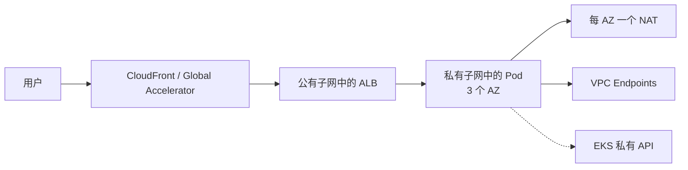

# EKS 生产基线

> 一套有明确观点、尽量精简的 Amazon EKS 生产环境 Terraform 基线。

[](https://github.com/kudig-io/aws-outbound-toolkit/actions/workflows/eks-blueprint.yml)
[](https://www.terraform.io)
[](../../LICENSE)

[English](./README.md) | **简体中文**

大多数 EKS 示例到“集群创建成功”就结束了。本基线关注的是决定集群能否安全生产运行的默认配置：
私有端点、三可用区网络、IRSA 所需的 OIDC、控制面日志、EKS Access Entry，以及可替换的托管节点组。

## 状态

**早期参考基线。** 配置已在 CI 中完成格式检查与 validate，但尚未在本仓库中应用到真实 AWS 账号。
请先审阅 plan、适配你的账号结构，并在沙箱环境验证后再上生产。

## 包含内容

| 领域 | 内容 |
| --- | --- |
| 网络 | 三可用区 VPC、公有/私有子网、每 AZ 一个 NAT、VPC Flow Logs |
| 集群 | 默认私有 API 端点、五种控制面日志全部开启 |
| 身份 | IRSA 所需 OIDC Provider、EKS Access Entry（`authentication_mode = "API"`） |
| 计算 | 托管节点组、默认 Graviton（`m7g`）、多可用区 |
| 插件 | 托管 `vpc-cni`、`coredns`、`kube-proxy` |
| 文档 | 架构、快速开始、Day-2 运维、Helm values 示例 |

## 架构



完整布局与设计理由见 [docs/architecture.md](./docs/architecture.md)。

## 快速开始

```bash
# 1. 配置变量
cp examples/prod.tfvars terraform/terraform.tfvars
$EDITOR terraform/terraform.tfvars

# 2. 格式检查与 validate
make fmt-check
make validate

# 3. Plan 与 apply
make plan
make apply

# 4. 连接集群
aws eks update-kubeconfig \
  --name "$(terraform -chdir=terraform output -raw cluster_name)" \
  --region ap-southeast-1
kubectl get nodes
```

执行 apply 前请先阅读 [docs/getting-started.md](./docs/getting-started.md)，其中包含远程 state、
Access Entry 和插件安装说明。

## 目录结构

```text
terraform/
  main.tf            根模块：network + EKS
  modules/network/   VPC、子网、NAT、Flow Logs
  modules/eks/       集群、OIDC、节点组、插件
examples/
  prod.tfvars        生产变量示例
helm/
  values/            ALB Controller 与 Karpenter 的 values 示例
docs/
  architecture.md
  getting-started.md
  day-2-operations.md
```

## 设计决策

| 决策 | 理由 | 何时调整 |
| --- | --- | --- |
| 默认私有 API 端点 | 减少公网攻击面，配合 VPN/CI Runner 使用 | 需要公网访问且已有严格 CIDR 限制 |
| `authentication_mode = "API"` | Access Entry 可审计，避免 `aws-auth` 漂移 | 仍依赖 ConfigMap 授权 |
| 默认 Graviton | 更好的性价比 | 镜像仅支持 amd64 |
| 托管节点组 | 启动和升级更简单 | 需要动态、多样化容量 → 增加 Karpenter |
| 每 AZ 一个 NAT | AZ 故障不影响整体出网 | 非生产环境降本 |
| 开启 Flow Logs | 网络取证与成本可见性 | 需按成本调整保留期 |

## 刻意不包含

- AWS Load Balancer Controller、Karpenter、external-dns、cert-manager 的安装
- 可观测性栈（OpenTelemetry、Prometheus、Grafana）
- CI/CD 流水线与部署角色
- Route 53、ACM、WAF、CloudFront
- 多区域灾备
- 应用层安全与多租户隔离

这些取决于你的平台与合规要求。[`helm/values/`](./helm/values/) 下的示例可作为其中前两项的起点。

## Roadmap

- [ ] Karpenter 模块（控制器 IRSA、节点角色、SQS 中断队列、NodePool 示例）
- [ ] AWS Load Balancer Controller IRSA 模块，锁定 IAM 策略版本
- [ ] ExternalDNS 与 cert-manager 示例
- [ ] OpenTelemetry Collector 与 SLO 看板
- [ ] 可选的多区域灾备模式
- [ ] 模块的 `terraform test` 覆盖

## 相关项目

- [kudig-io/aws-outbound-playbook](../../playbook) — AWS 出海实战手册
- [kudig-io/aws-cost-doctor](../../tools/cost-doctor) — AWS 成本与闲置资源扫描器
- [kudig-io/klaw](https://github.com/kudig-io/klaw) — Kubernetes 诊断与运维平台

## 参与贡献

见 [CONTRIBUTING.md](./CONTRIBUTING.md)。提交 PR 前请执行 `make fmt-check validate`。

## 声明

本项目**与 Amazon Web Services (AWS) 无任何隶属、背书或赞助关系**。AWS 及相关标识是
Amazon.com, Inc. 或其关联公司的商标。本项目是社区参考实现，不是经过认证的模块；落地前请结合
自身安全与合规要求进行评估。

## 许可证

[Apache-2.0](../../LICENSE)