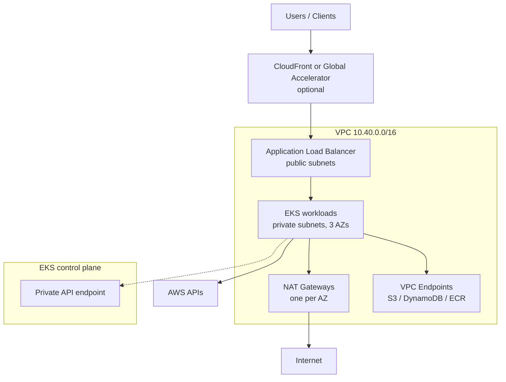

# Architecture

## Network layout

| Tier | Subnets | Purpose |
| --- | --- | --- |
| Public | `cidrsubnet(vpc, 8, 0..n)` | Load balancers, NAT gateways |
| Private | `cidrsubnet(vpc, 8, 10+n)` | Nodes and pods |

The module tags subnets for the AWS Load Balancer Controller:

- public: `kubernetes.io/role/elb = 1`
- private: `kubernetes.io/role/internal-elb = 1`

## Access model

- The cluster uses `authentication_mode = "API"`, so access is managed with **EKS access entries**,
  not the legacy `aws-auth` ConfigMap.
- `bootstrap_cluster_creator_admin_permissions = true` grants the creating identity cluster-admin.
  Remove or narrow this for shared production accounts.
- Workloads should use **EKS Pod Identity** or **IRSA**. The module creates an OIDC provider so IRSA
  roles can be added without recreating the cluster.

## Compute

- One managed node group, spread across the private subnets in three AZs.
- Graviton (`m7g`) is the default for price/performance; change `node_instance_types` if images are
  amd64-only.
- Autoscaling is configured at the node group boundary (`desired/min/max`). Karpenter is documented
  but not installed by this module.

## What the blueprint does not create

- CloudFront distributions, Route 53 zones, certificates, or WAF rules
- AWS Load Balancer Controller, Karpenter, external-dns, cert-manager, or observability agents
- CI/CD roles and pipelines
- Backup, disaster recovery, or multi-region replication
- Tenant isolation or application-level security controls

These are intentional gaps: they depend on your account structure, domain, and compliance posture.
